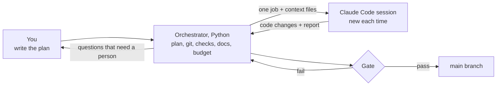
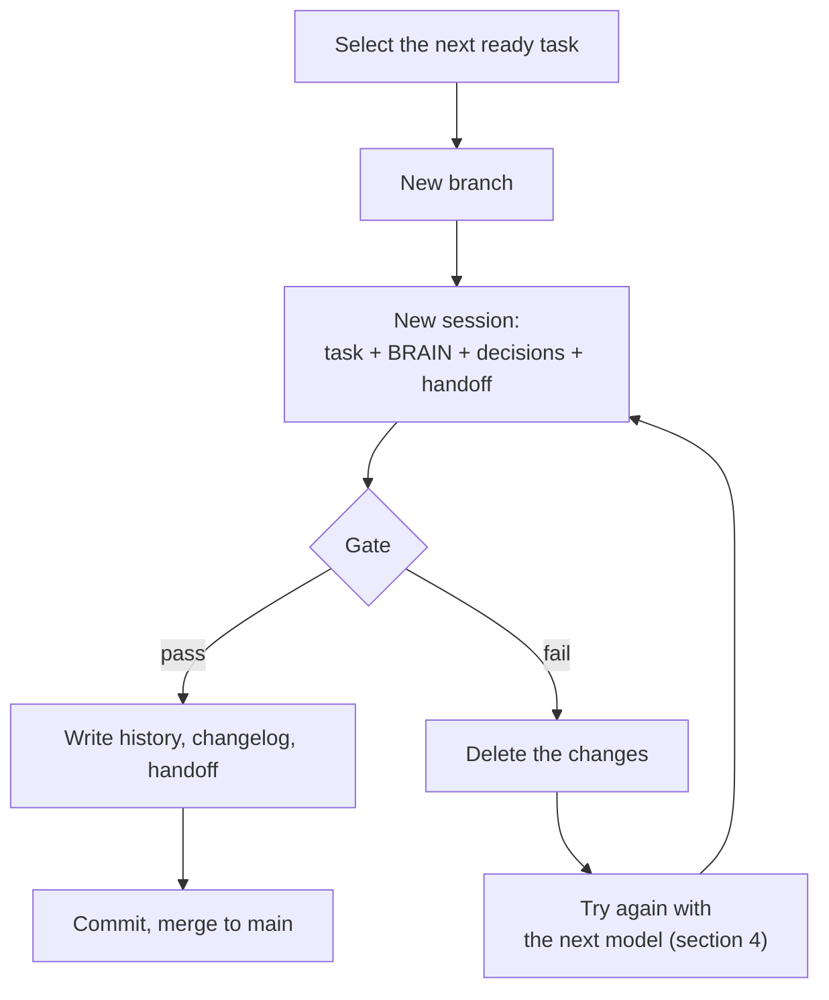
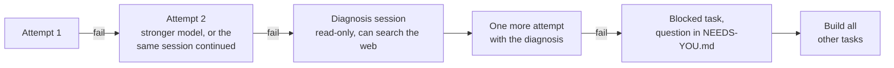
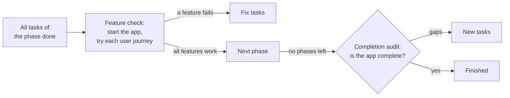
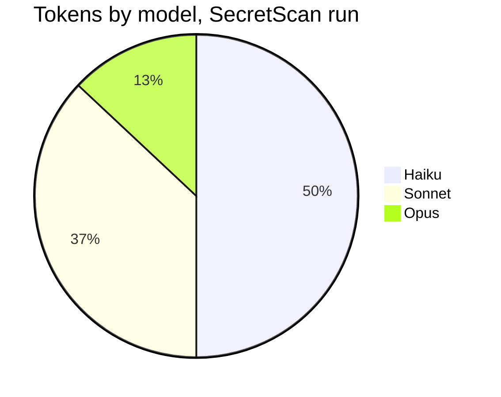
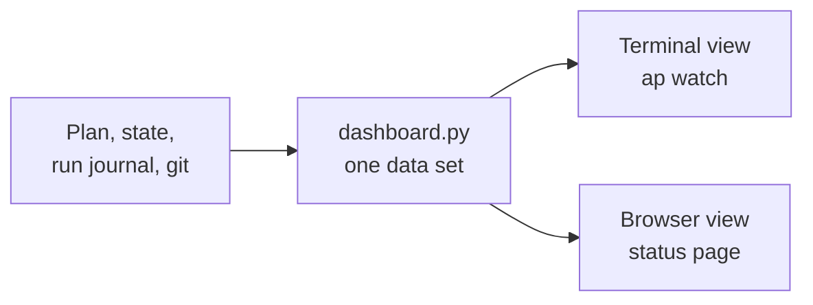

# Autopilot architecture

Autopilot builds your software project while you are away. You write what you want in plain words and start it once. You get working software, tested, with a record of every step.
It is for one developer, or for a person with an idea and a developer friend.

This page explains how Autopilot works and why. The main idea: **the AI model writes the code, and Python code
decides what to keep.** Words on this page: Claude Code (the coding agent that writes the code), the gate (the check after each step), a worktree (a separate copy of the project for one task), a subscription (a paid Claude plan).

For the steps to use Autopilot, read the [tutorial](GUIDE.md). For all commands and settings, read the
[reference](REFERENCE.md).

## 1. Who does what

| Part | Controls |
|---|---|
| **Orchestrator** | The plan, the progress, all git commands, the checks, the docs, the deploys, the model choice, and the budget |
| **Claude Code session** | One job: the code for one task, or one review |
| **You** | The plan. Later: the answers in `docs/NEEDS-YOU.md` and the production approvals |

## 2. Life of one task

## 3. The gate

The orchestrator runs the gate after each task. It never accepts the "done" message of the agent as proof.

| Check | Finds | Result |
|---|---|---|
| Build, lint, typecheck, tests | A command from your settings that fails | Fail |
| Test-tamper guard | A deleted, skipped or empty test, weaker test settings, or a changed CI file | Fail |
| Secret scan | An added line that looks like a key, a token, or a password | Fail |
| Protected files | Changes to the plan, the settings, or the questions file | Fail |
| Empty diff | No change | Fail |
| New file | An added file with no reason in the report field `new_files` (test files, `.agent/` and renames excepted; on with `gate.new_file_reasons: true`) | Fail |
| Scope | A changed file outside `files_in_scope`. Docs in `gate.scope_always` and files the report adds with a reason are allowed. With `gate.scope_fail: false` the result is a warning | Fail |
| Kill by name | A session that stops processes by name (`taskkill /IM`, `pkill`, `killall`, `Stop-Process -Name`) | Fail |
| Feature contract | A removed test or rule that a page in `features/` names, with no `changed` and `why` in the report | Fail |
| File growth | A code file that grows past 400 lines or 25 percent in one task (`gate.file_growth`) | Fail |
| Layers | A new import that breaks the `layers` block of `BRAIN.md` | Fail |
| Dependency | A changed dependency manifest with no declared `new_deps` | Fail |

The agent gets these rules before it starts, so it can obey them on the first attempt.

Two more checks run outside the task gate. Before the next task, Autopilot tests each new commit on `main`. A red `main`
goes to the fixer first. A task report can list tests under `failing_before`. The orchestrator checks these names
against the test result of `main`.

The agent edits the file that owns the content. A move or a rename is allowed. Each new file (test files excepted)
needs a reason in the report field `new_files`. The task commit gets one line per new file:
`new file <path>: <reason>`.
When `gate.new_file_reasons` is `true`, the gate checks the reasons. A new file with no reason fails the
attempt, and the retry prompt quotes the rule. The template turns the setting on for new projects. A project file with no such key keeps it off.

## 4. When a task fails

The run never stops for one task.

This is the `full` profile: 3 attempts (`retries.max_attempts_per_task`). The diagnosis session starts after attempt 2
(`unstick.after_attempts`). The `lean` profile is the default for new projects. It allows 2 attempts, runs no
diagnosis session, and then blocks the task.

## 5. When a phase or the plan is complete

The `lean` profile tries no variation in the feature check and runs no completion audit. Run `ap audit` for an audit.

## 6. Models: low cost first, stronger when necessary

| Task risk | Attempt 1 | Attempt 2 | Attempt 3 |
|---|---|---|---|
| Low | Sonnet | Sonnet | Opus |
| Medium | Sonnet | Sonnet | Opus |
| High | Sonnet | Opus | Opus |
| Critical | Opus | Opus | Opus |

These are the values of the project template (`models.ladder`). You can change them.

After its checks pass, one read-only Opus review looks at the change before the merge. The template sets
`review.scope: all`: every task above low risk gets the review. The code default is `critical`: only critical tasks.

A failed task goes to a stronger model, never to a weaker one. This chart shows the real share of tokens in the
SecretScan run (38 sessions):

## 7. Why each design choice

| Problem of long agent runs | Design choice |
|---|---|
| The agent forgets context after many hours | One new session for each task. The memory is in files |
| The agent says "done" when the work is not done | Python runs the checks. The agent cannot change them |
| One failed task stops all work | Retry, then a stronger model, then a blocked task. The other tasks continue |
| `main` fails its checks | A fixer session repairs `main` before new work starts |
| Risky design choices without thought | A high-risk task first compares 2 or 3 designs. The choice goes to `docs/adr/` |
| Missing parts at the end | The completion audit adds fix tasks (`full` profile) |
| A deploy fails | A health check, an automatic rollback, and a fix task |
| A crash or a restart of the computer | The state is in files and SQLite. The run continues from the last point |

## 8. Self-healing

| Problem | What happens |
|---|---|
| A usage limit or a rate limit | The run sleeps until the window resets. A subscription run also pauses before the limit |
| The Claude CLI, the login or the network is down | The run waits, then starts the same session again. The waits grow from 1 minute to 1 hour. After three server errors in 15 minutes, it waits 15 minutes, up to 4 times, and then stops |
| A tool is missing | The run does the setup again, then starts one repair session. A run gets one repair session |
| `main` fails its checks | A fixer session repairs it before more work. It gets three attempts by default |
| The push fails, or `main` is different from GitHub | The run tries again after 30 seconds, then continues on your computer and tries at each commit. You get one alert |
| The plan file or the state file is damaged | The run restores the last good copy: the plan from the last 30 commits on `main`, the state from the backup of the run start |
| Autopilot stops with an error | Autopilot starts again from the saved state, 10 times at most. The same crash three times on one task parks that task |
| A newer release exists | Before `ap run` or `ap start`, once a day, Autopilot installs it and starts the same command again on the new version. After a short command it installs in the background. Every update line names the way back, `ap upgrade --ref vX.Y.Z` |

A limit or an outage never counts as a failed attempt. The full list is in the
[reference](REFERENCE.md#self-healing).

The update that runs by itself has three rules. It runs only when the user types an `ap` command, never on a timer.
It checks the release at most once a day. It never changes the code while a build is active. Before `ap run` or
`ap start` the check runs first: a release install (uv tool or pip) downloads the wheel, compares it with
`SHA256SUMS`, starts the reinstall after the process has exited (Windows locks `ap.exe` while it runs), and then
starts the same command again on the same console. A git checkout, `CI`, `AUTOPILOT_NO_AUTO_UPGRADE=1`,
`AUTOPILOT_DETACHED` and `upgrade.auto: false` stop it. Any failure lets the command run on the current
version.

## 9. Memory is in files

| File | Content |
|---|---|
| `.agent/plan.yaml` | The phases and the tasks |
| `.agent/BRAIN.md` | The architecture and the rules. Each session reads it |
| `.agent/DECISIONS.md` | The log of decisions |
| `.agent/HANDOFF.md` | What the last session did |
| `.agent/history/` | A record for each task, and a `PROOF.md` for each phase with the full evidence of the feature check |
| `.agent/state.db` | The progress, the sessions, and the cost |
| `.agent/run.json` | What the run does now. The dashboard reads it |
| `.agent/FOLLOWUPS.md` | Small items that the sessions report, for later |
| `.agent/quality_baseline.json` | The file sizes and growth numbers that the gate compares |
| `.agent/history/<phase>/receipt.json` | The signed receipt of a closed phase (`ap verify` checks it) |
| `.agent/history/<phase>/proof.svg` | One proof card for each closed phase |
| `docs/NEEDS-YOU.md` | Questions for you |

No session needs a long chat history. After a crash or a restart, the run continues from these files.

## 10. Trust boundary

> [!WARNING]
> Run Autopilot in a sandbox on a server. Sessions run without permission prompts. The `deploy/` folder has a
> Dockerfile and a systemd unit.

- Sessions cannot commit, push, or change branches. Only the orchestrator uses git.
- The orchestrator turns git hooks off for its git commands. It restores `.git/config` after each session.
- Sessions and checks get only the environment variables on an allowlist, not your full environment.
- Research sessions can read the web, but get no shell.

## 11. Code map

| File | Job |
|---|---|
| `cli.py` | All commands |
| `orchestrator.py` | The main loop |
| `plan.py` | Loads the plan and selects the next task |
| `gate.py` | The checks |
| `plan_find.py` | Finds the plan document in your folder by its content |
| `scope_files.py` | Gives the text of the files of a task to its prompt |
| `contracts.py` | Feature contracts: the pages in `features/`, and the gate check for them |
| `repomap.py` | A short index of the helper functions, so sessions reuse code |
| `layers.py` | The layer check of imports (`BRAIN.md`) |
| `growth.py` | Growth numbers at each phase close, and the consolidate task |
| `receipt.py`, `card.py` | The signed receipt and the proof card of a phase |
| `signals.py` | Records session errors that no known pattern matches |
| `outage.py` | The rules for a server outage, an expired login, and a repeated error |
| `proc.py` | Process helpers: whole-tree kill on timeout, run lock, least-privilege environment |
| `inbox.py`, `watch_input.py`, `answers.py` | A line typed in `ap watch`: the inbox file, the input row, and local answers |
| `handoff.py` | Hands a task to the next runner at a long usage limit |
| `kill_guard.py` | Finds a kill by name (`taskkill /IM`, `pkill`, `killall`, `Stop-Process -Name`) in a session log, for the gate |
| `gitops.py` | All git commands |
| `context.py` | Makes the prompt of each session from the files |
| `state.py` | The SQLite state |
| `docs.py` | Writes the history, the changelog, the handoff, and the RCA log |
| `decisions.py` | `docs/NEEDS-YOU.md` |
| `report.py` | The status report, the status line, and the live page |
| `dashboard.py` | The data of the dashboard for the terminal and the browser |
| `dash_term.py`, `dash_web.py` | The dashboard in the terminal and on the status page |
| `dash_card.py`, `dash_live.py` | The Now card and the facts about a live run (`Waiting for` line, heartbeat) |
| `notify.py` | Telegram, Slack, ntfy, and webhook alerts |
| `deploy.py` | Deploy, health check, and rollback |
| `doctor.py` | Checks of your computer, and safe repairs |
| `upgrade.py` | `ap upgrade`, `ap install`, and the update that runs by itself (see section 8) |
| `commands/` | The commands `audit`, `precheck`, `preflight`, `setup`, and `tour` |
| `backends/` | Runs Claude Code, or a different agent CLI. `docker_box.py` runs a session in a container |
| `prompts/` | The prompt text for each type of session |

## 12. The dashboard

`ap watch` shows a dashboard in a terminal window of 100 x 24 or larger. The status page shows the same dashboard
in the browser. One module makes the data, and two views draw it. Thus the terminal and the browser always agree.

| Panel | Content |
|---|---|
| Now card | The task or step now, and the `Waiting for` line with the last tool and its time |
| Project | The status, questions for you, the task now, the next task, the size, the last commit, the phases |
| Tasks | Each task with its status, its time, and its model |
| Live output | The steps of the session in plain words |
| Progress, Usage, Files, Issues | The counts, the usage windows, the changed files, the blocked tasks, and the warnings |

## 13. Claude Code alone and with Autopilot

| | Claude Code alone | With Autopilot |
|---|---|---|
| Direction | Claude can choose the design as it works. | Your plan sets the design. The gate refuses a change to the plan. |
| Run time | You give the next step in the chat. | `ap start` runs all tasks in the background. |
| Context | A long chat can lose early detail. | Each task starts a new session with a short brief. |
| Checks | The model can say that work is done. | Autopilot runs your build, lint and test commands. A task merges only if they pass. |
| Test honesty | A test can be deleted or skipped. | The gate refuses deleted tests, fewer tests, fewer assertions and skip markers. |
| Failures | You find and repair a problem. | A stronger model tries again. Autopilot repairs a missing tool or a red main branch, and restarts after a crash. |
| Questions | The chat waits for you. | That task and its dependent tasks wait. Other tasks continue. |
| Status | You scroll the chat. | `ap watch` shows tasks, live output, progress and usage. |
| Git | You manage branches. | One branch for each task. It merges only after green checks. |
| Review | The model checks its own work. | Tasks above low risk get a separate review (critical tasks only in older projects). A final audit adds repair tasks. |

Use Claude Code alone for a small change, a question, exploration, or a design that is not decided.
