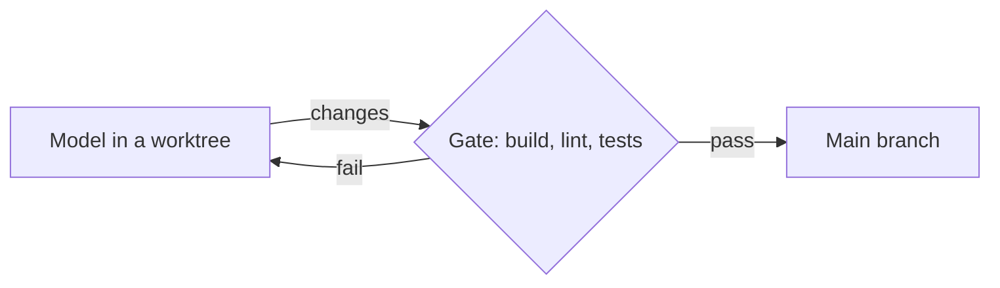

# Why Autopilot and not only skills

Autopilot builds your software project while you are away. You write what you want in plain words and start it once. You get working software, tested, with a record of every step.

**Skills tell the model how. Autopilot proves it did.**

This page explains the difference. It does not give steps or settings. For those, see the [Reference](REFERENCE.md) and the [How-to guides](HOWTO.md).

## What can go wrong

You can write skills for your own needs. A skill is useful. The question is who checks that the model followed it. Each row below is a risk. Each column is a way to work.

| What can go wrong | Claude Code alone | Claude Code + skills | Copilot + skills | Autopilot (any runner) |
|---|---|---|---|---|
| Who says a task is done | The model | The model, after it reads a skill | The model, after it reads a skill | Your build, lint, and test commands |
| A skill is not loaded or is dropped | Not applicable | The listing can hide some descriptions (see below) | A skill is text, so the same risk applies | The gate does not depend on a skill |
| A hook is rewritten or bypassed | Not applicable | A hook is a command the model can edit (see below) | A hook is a command the model can edit | The gate is Python code outside the model's worktree |
| A test is deleted or skipped | The model can do it | A skill can ask the model not to | A skill can ask the model not to | The gate refuses deleted tests, fewer assertions, and skip markers |
| The plan changes in the middle of a run | The model can choose another design | A skill can suggest, not enforce | A skill can suggest, not enforce | The gate refuses a change to the plan |
| A long chat loses detail | Early detail can fade | Skills help, the chat still grows | Skills help, the chat still grows | Each task starts a new session with a short brief |
| A question arrives in the night | The chat waits for you | The chat waits for you | The chat waits for you | That task waits. Other tasks continue |
| A crash or an outage | You restart and find your place | You restart and find your place | You restart and find your place | Autopilot restarts and waits out an outage |
| A cost cap | You watch the usage | You watch the usage | You watch the usage | A budget stops the run |
| The record at the end | A chat to scroll | A chat to scroll | A chat to scroll | A log of every step, with a receipt for each task |

## What a skill is and is not

A skill is a text that the model may read. The model decides if a skill applies.

A hook is a command that runs at a set point. The model may bypass or rewrite it.

A loop ends when the model says it is done. A passing test count is only as good as the tests.

The Autopilot gate is Python code. The model cannot edit it, because the model works in a separate worktree and the gate lives outside it. The gate runs your build, lint, and tests. A task merges only if they pass.

## Skills still work inside Autopilot

Every Autopilot session is a normal Claude Code or Copilot session. Your `CLAUDE.md` loads. The project's own `.claude/settings.json` and `.mcp.json` also load. So the skills, hooks and servers that you keep in the project work as usual.

Your personal settings, plugins, hooks and servers do not load by default. This keeps a run the same on each computer and keeps the cost low. To load them, set `agent.user_config: true`.

Skills and Autopilot do different jobs. A skill guides the model. The gate checks the result.

## When Claude Code or Copilot alone is the right tool

Use Claude Code alone for a small change, a question, exploration, or a design that is not decided. Autopilot adds a plan, a gate, and a record. A small change does not need them.

## What others found

These cases come from public sources. The list shows each case as reported. The Sources section gives the date of each read.

- **A loop wrote DONE and was wrong.** On orbi.build, a loop reached 15 of 15 passing tests and wrote DONE. A separate review then found a spec violation. None of the 28 tests used an em dash or a currency sign.
- **Skill descriptions are dropped without a warning.** A dev.to post says Claude Code lists each skill's name and description in context. The post says the listing has a budget. When many skills are installed, the least-used skills lose their descriptions first, with no warning in the interface.
- **Hooks can fail silently or be rewritten.** An RFC in the Claude Code project (issue 45427) reports a hook that returns an error while the tool call still runs. It also reports a model that edits hook scripts or settings. The issue is now closed and locked.

## Numbers from the run log

| Project | Result | Cost per run at API prices |
|---|---|---|
| SecretScan | 27 of 27 tasks | $17.13 |
| envguard | 21 of 21 tasks | $19.01 |

Both runs had 0 decisions by a person. These numbers come from the run log. The [README](README.md) has the full table.

## Sources

Read on 2026-10-14.

- orbi.build, "Ralph loop's code passed 28 tests, then failed review": https://orbi.build/blog/ralph-loop-claude-code/ (read 2026-10-14)
- dev.to, "Your Claude Code skills are being silently demoted": https://dev.to/haoli/your-claude-code-skills-are-being-silently-demoted-i-built-a-cli-to-catch-it-454e (read 2026-10-14)
- anthropics/claude-code issue 45427, "RFC: Deterministic tool gate": https://github.com/anthropics/claude-code/issues/45427 (read 2026-10-14)
- Claude Code documentation, "Skills": https://code.claude.com/docs/en/skills (read 2026-10-14)
