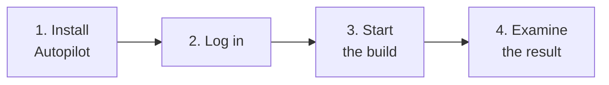

# Tutorial: build your first project

Autopilot builds your software project while you are away. You write what you want in plain words and start it once. You get working software, tested, with a record of every step.
It is for one developer, or for a person with an idea and a developer friend.

This tutorial takes you from an idea to a working app. Your part takes a few minutes. The run can take some hours,
and you do not have to watch it.

| Other pages | Use them to |
|---|---|
| [How-to guides](HOWTO.md) | Do one specific job: a server, phone alerts, a project that already exists |
| [Reference](REFERENCE.md) | Look up a command, a setting, a file, or a term |
| [Architecture](ARCHITECTURE.md) | Understand how Autopilot works and why |



## Before you start

You need a paid Claude plan (Pro or Max) or an API key (a key for pay-as-you-go use). The free Claude plan cannot use Claude Code (the coding agent that writes the code).

The first install takes approximately 4 minutes.

## Step 1: Install Autopilot

One line, on every system, with [uv](https://docs.astral.sh/uv/). It installs Python if needed:

```powershell
uv tool install dev-autopilot
```

No uv? Run the install script instead. It installs uv, Python, Claude Code and Autopilot for your user, with no
administrator prompt. Windows (PowerShell):

```powershell
irm https://raw.githubusercontent.com/manishjnv/AutoPilot/main/install.ps1 | iex
```

macOS, Linux or WSL:

```bash
curl -fsSL https://raw.githubusercontent.com/manishjnv/AutoPilot/main/install.sh | bash
```

Both end with the same result: `ap` is ready. The package name on PyPI is `dev-autopilot`; the command is `ap`.

The install adds two commands: `autopilot` and its short name `ap`. This tutorial uses `ap`.

## Step 2: Log in

Nothing to type. The first `ap` run opens the Claude login in your browser when you are not logged in yet.
You need a paid Claude plan (Pro or Max).

## Step 3: Start the build

Give your idea to Autopilot:

```powershell
ap quickstart -C myapp --idea "a todo list CLI with due dates" --run
```

This one command:

1. Makes the folder `myapp`.
2. Writes `PLAN.md` from your idea, and makes the tasks.
3. Checks your computer.
4. Starts the build.

> [!TIP]
> To answer the same questions step by step, run `ap` with no arguments. In a folder that already has code, `ap` adopts it: it reads the code and the plan
> documents, keeps finished work done and shows a short summary before it asks to start. If you have your own plan, see
> [Use a project that already exists](HOWTO.md#use-a-project-that-already-exists).

While the build runs:

- Your browser opens the live status page at `http://127.0.0.1:8765/`. To prevent this, add `--no-browser`.
- Each task shows a line, for example `▸ P01-T01 Project skeleton [haiku] · 1m12s`.
- The bottom row of the terminal shows the status line.
- Do not stop the run. Autopilot repairs failures and does not wait for you.

To follow the run from a different terminal, run `cd myapp`, and then use one of these commands:

| To see | Do this |
|---|---|
| Each step, live | `ap watch`. Ctrl+C stops the watch, not the run |
| A snapshot of the progress | `ap status` |
| All log lines | Open `.agent/logs/autopilot.log` |

If Autopilot has a question for you, it writes the question in `docs/NEEDS-YOU.md` and builds the other tasks. To
answer, run `ap answer`. See [Answer a question from Autopilot](HOWTO.md#answer-a-question-from-autopilot).

## Step 4: Examine the result

- At the end of the run, a message shows what Autopilot built, the blocked tasks, and the questions for you. It also
  shows an estimate of the work that remains.
- A `Not verified` line in the message shows the work that no check covered. Examine that work yourself.
- `ap stats` shows the number of tasks done, the cost, the time and what you had to do.
- The code is on the `main` branch. `CHANGELOG.md` lists the changes, and `docs/RCA.md` lists the bugs and their
  causes.

## Next steps

- To add features later, see [Add features after a run](HOWTO.md#add-features-after-a-run).
- To run Autopilot all night on a server, see [Run Autopilot on a server](HOWTO.md#run-autopilot-on-a-server).
- To learn what each command does, see [Commands](REFERENCE.md#commands).
- To get a newer version, run `uv tool install --reinstall git+https://github.com/manishjnv/AutoPilot`.
