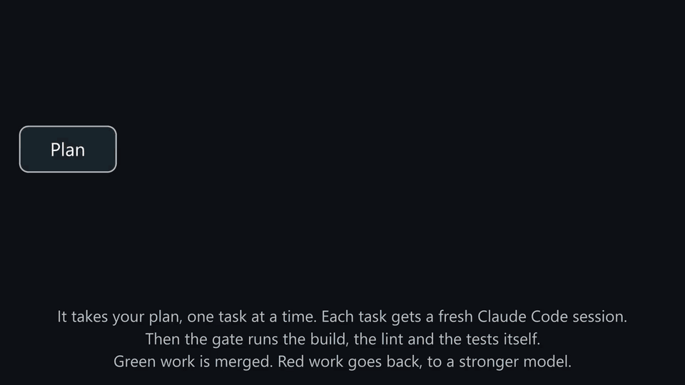
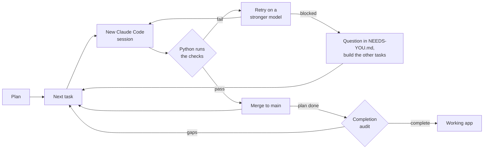
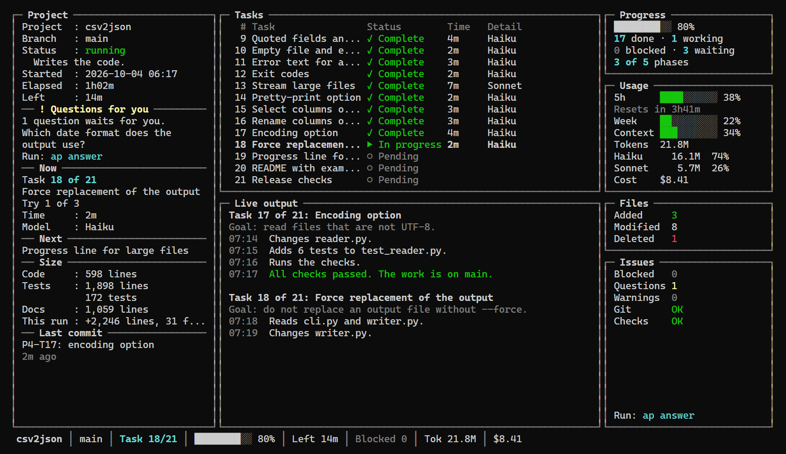
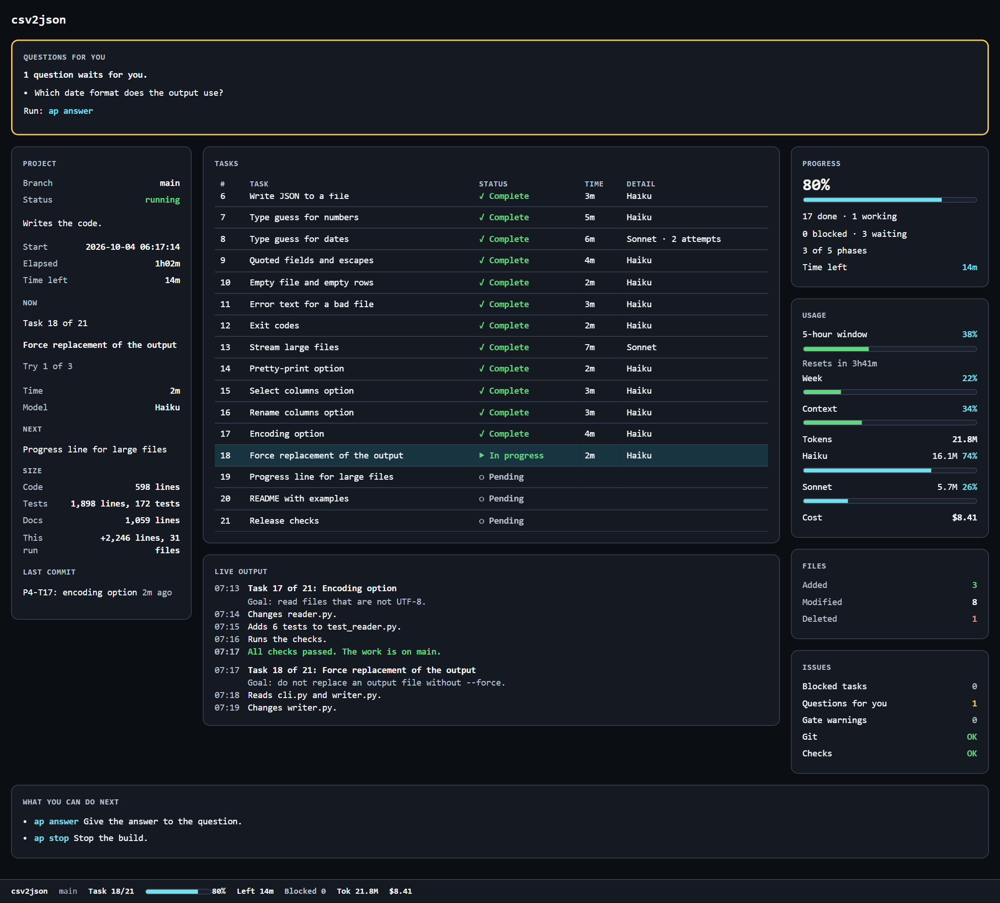

# Autopilot

Autopilot builds your software project while you are away. You write what you want in plain words and start it once. You get working software, tested, with a record of every step.
It is for one developer, or for a person with an idea and a developer friend.

**Give it a plan tonight. Wake up to a working app, and proof that it works.** Claude Code (the coding agent) writes the code; Python code decides when a task is complete.

[](https://github.com/manishjnv/AutoPilot/actions/workflows/ci.yml)

[](LICENSE)

## Claude Code alone and with Autopilot

| | Claude Code alone | With Autopilot |
|---|---|---|
| Direction | Claude can choose the design as it works. | Your plan sets the design. The gate refuses a change to the plan. |
| Checks | The model can say that work is done. | Autopilot runs your build, lint and test commands. A task merges only if they pass. |
| Failures | You find and repair a problem. | A stronger model tries again. Autopilot repairs a missing tool or a red main branch. |
| Questions | The chat waits for you. | That task waits. Other tasks continue. |
| Status | You scroll the chat. | `ap watch` shows tasks, output, progress and usage. |

The [full comparison](ARCHITECTURE.md#13-claude-code-alone-and-with-autopilot) has ten rows. Use Claude Code alone
for a small change, a question, or an open design.

## How it works





## Follow the build

`ap watch` shows the build in the terminal; the status page shows the same data in your browser (sample data).





## Real results

Two real projects, both CLIs built from a plan:

- **SecretScan** finds leaked secrets in a repository.
- **envguard** checks `.env` files against a schema and finds secrets in the git history.

| Measure | SecretScan | envguard |
|---|---|---|
| Tasks merged | **27 of 27**: 13 from the plan, 14 from the audits | **21 of 21**: 11 from the plan, 10 from the audits |
| Blocked tasks | **0** | **0** |
| Passed on the first attempt | 25 of 27 | 17 of 21 |
| Decisions that needed a person | **0** | **0** |
| Agent time | 2.2 hours, 38 sessions | 1.4 hours, 42 sessions |
| Cost at API prices | $17.13 | $19.01 |

Both runs used a subscription. The envguard audits found 8 real bugs; Autopilot fixed all. envguard is private; numbers come from the run log. A lean rerun of envguard used 39.5 percent fewer tokens per task.

## Install

Windows (PowerShell):

```powershell
irm https://raw.githubusercontent.com/manishjnv/AutoPilot/main/install.ps1 | iex
```

macOS, Linux or WSL:

```bash
curl -fsSL https://raw.githubusercontent.com/manishjnv/AutoPilot/main/install.sh | bash
```

On Windows pick Windows or WSL, not both; WSL only for the sandbox.
Open a project folder and type `ap`. See [What `ap` does](HOWTO.md#what-ap-does-in-a-folder).

The script installs what is missing: git, uv, Claude Code, Python, and Autopilot. You need a paid Claude plan (Pro
or Max). After a release, run `ap upgrade`. For a repair or a second machine, run `ap install`. For the checksums
and each step, see [Install with one script](HOWTO.md#install-with-one-script).

## Example output

Shortened real output, a skipped test and the retry:

```text
task P02-T01 attempt 1 failed: PROBLEM: skip/focus marker added in tests/test_walker.py
session #10 task P02-T01 model=sonnet attempt=2
task P02-T01 done (sonnet, $0.39)
audit: completion audit: 92% complete, 8 corrective tasks (FIX001)
```

## Documentation

| To | Read |
|---|---|
| Build your first project, step by step | [Tutorial](GUIDE.md) |
| Do one job: a server, phone alerts, an existing project | [How-to guides](HOWTO.md) |
| Look up a command, a setting, a file, or a term | [Reference](REFERENCE.md) |
| Understand how Autopilot works and why | [Architecture](ARCHITECTURE.md) |

## Good to know

> [!WARNING]
> Use a sandbox on a server: sessions run without permission prompts. See
> [Run Autopilot on a server](HOWTO.md#run-autopilot-on-a-server).

- Version 0.3.0, an early release. [MIT license](LICENSE).
- One CLI agent per session. See [limits and runners](HOWTO.md#limits-and-supported-agent-clis).
