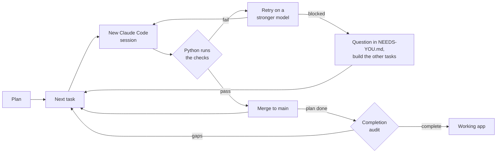

# Autopilot

Autopilot builds your software project while you are away. You write what you want in plain words and start it once. You get working software, tested, with a record of every step.
It is for one developer, or for a person with an idea and a developer friend.

Python decides when a task is done, not the model. Every step is recorded. Works on Windows. Runs any coding agent CLI.

**Give it a plan tonight. Wake up to a working app, and proof that it works.** Claude Code (the coding agent) writes the code; Python code decides when a task is complete.

[](https://github.com/manishjnv/AutoPilot/actions/workflows/ci.yml)

[](LICENSE)

## Claude Code alone and with Autopilot

| | Claude Code alone | With Autopilot |
|---|---|---|
| Direction | Claude can choose the design as it works. | Your plan sets the design. The gate refuses plan changes. |
| Checks | The model can say that work is done. | Autopilot runs your build, lint and test commands. A task merges only if they pass. |
| Failures | You find and repair a problem. | A stronger model tries again. Autopilot repairs a missing tool or a red main branch. |
| Questions | The chat waits for you. | That task waits. Other tasks continue. |
| Status | You scroll the chat. | `ap watch` shows tasks, output, progress and usage. |

The [full comparison](ARCHITECTURE.md#13-claude-code-alone-and-with-autopilot) has ten rows.

## How it works




## Follow the build

`ap watch` shows the build in the terminal; the status page shows the same data in your browser (sample data).


## Real results

Two real projects built from a plan:

- **SecretScan** finds leaked secrets in a repository.
- **envguard** checks `.env` files against a schema and finds secrets in the git history.

| Measure | SecretScan | envguard |
|---|---|---|
| Tasks merged | **27 of 27**: 13 from the plan, 14 from the audits | **21 of 21**: 11 from the plan, 10 from the audits |
| Blocked tasks | **0** | **0** |
| Passed on the first attempt | 25 of 27 | 17 of 21 |
| Decisions that needed a person | **0** | **0** |
| Agent time | 2.2 hours, 38 sessions | 1.4 hours, 42 sessions |
| Cost at API prices | $17.13 | $19.01 |

Both runs used a subscription. The envguard audits found 8 real bugs; Autopilot fixed all. envguard is private; numbers come from the run log.

## What every run proves

- [Outcome word](REFERENCE.md#run-outcome): every run ends with VERIFIED, BLOCKED, BUDGET_STOP, STALLED or FAILED.
- [Not proven list](REFERENCE.md#not-proven-list): each phase lists the criteria that no changed test mentions.
- [Replay](REFERENCE.md#commands): `ap tour` replays a recorded run offline, with no login and no network.
- [Fresh review](REFERENCE.md#fresh-context-review): a fresh session reviews each task before it merges.
- [Signed receipt](REFERENCE.md#signed-receipt): `ap verify` checks each closed phase against its signature.
- [Draft PR](REFERENCE.md#draft-pull-request): a task with a warning or an untested criterion opens as a draft.
- [Proof card](REFERENCE.md#proof-card-and-badge): each closed phase writes `proof.svg` and a badge line.
- [Retry cost](REFERENCE.md#commands): `ap audit --history` prices your past retries in Claude Code.

## Safety

- The gate runs your build, lint and test commands before each merge.
- The plan cannot change during a run.
- Budget caps apply per task, phase, day and run ([settings](REFERENCE.md#settings)).
- A network allowlist applies when `sandbox.enabled` is true or `sandbox.mode` is `allowlist`.
- `sandbox.mode: docker` runs each Claude Code session in a plain container. Only the worktree is mounted, never your home folder ([settings](REFERENCE.md#settings)).
- Every task runs in its own git worktree.
- Secrets are scrubbed from logs.
- `ap run --no-prod` keeps production untouched.
- `ap verify` checks the signed record.

## Docs always in scope, and tests run once

A task may change `REFERENCE.md`, `CHANGELOG.md`, `HOWTO.md` and `README.md` without a scope addition. Add more paths to `gate.scope_always` in `project.yaml` to free other files. A code file outside the task scope still fails the gate.

The task gate runs only the tests of the changed modules (`gate.tests: changed`, the default). The phase close always runs the full test command. Set `gate.tests: full` to run the full command for every task. A bad `gate.scope_always` or `gate.tests` value is an error with a plain message. See `REFERENCE.md` for the settings.

## Install

Three steps, no administrator prompt.

1. Run one line in your shell.

   Windows (PowerShell):

   ```powershell
   irm https://raw.githubusercontent.com/manishjnv/AutoPilot/main/install.ps1 | iex
   ```

   macOS, Linux, WSL or Git Bash:

   ```bash
   curl -fsSL https://raw.githubusercontent.com/manishjnv/AutoPilot/main/install.sh | bash
   ```

   Windows (CMD):

   ```bat
   curl -o %TEMP%\install.cmd https://raw.githubusercontent.com/manishjnv/AutoPilot/main/install.cmd && %TEMP%\install.cmd
   ```

   Have Python 3.10 or newer? `pip install dev-autopilot && ap setup`.

2. Answer one question: which AI do you pay for (Claude, GitHub Copilot, Codex, Cursor or Kiro)? The script
   installs that one CLI and prints its login command. Copilot in VS Code is not a command-line tool. Autopilot
   needs the Copilot CLI, which uses the same subscription.
3. Open a project folder and type `ap`.

See [What `ap` does](HOWTO.md#what-ap-does-in-a-folder). Autopilot updates itself once a day; `ap uninstall --all`
removes it. Checksums and each step: [Install with one script](HOWTO.md#install-with-one-script).

## Example output

Shortened real output:

```text
task P02-T01 attempt 1 failed: PROBLEM: skip/focus marker added in tests/test_walker.py
session #10 task P02-T01 model=sonnet attempt=2
task P02-T01 done (sonnet, $0.39)
audit: completion audit: 92% complete, 8 corrective tasks (FIX001)
```

## Documentation

| To | Read |
|---|---|
| Build your first project | [Tutorial](GUIDE.md) |
| Do one job: a server, phone alerts, an existing project | [How-to guides](HOWTO.md) |
| Look up a command, setting, file or term | [Reference](REFERENCE.md) |
| How Autopilot works and why | [Architecture](ARCHITECTURE.md) |

## Good to know

> [!WARNING]
> Use a sandbox on a server: sessions run without permission prompts. See
> [Run Autopilot on a server](HOWTO.md#run-autopilot-on-a-server).

- Version 0.4.0, an early release. [MIT license](LICENSE).
- One CLI agent per session. See [limits and runners](HOWTO.md#limits-and-supported-agent-clis).