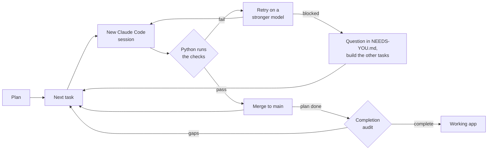

# Autopilot

**Give it a plan tonight. Wake up to a working app, and proof that it works.**

Autopilot runs Claude Code through your full plan, and you do not have to watch it. Python code, not the AI model,
decides when a task is complete.

[](https://github.com/manishjnv/AutoPilot/actions/workflows/ci.yml)

[](LICENSE)

## Claude Code alone and with Autopilot

| | Claude Code alone | With Autopilot |
|---|---|---|
| Direction | Claude can choose the design as it works. | Your plan sets the design. The gate refuses a change to the plan. |
| Checks | The model can say that work is done. | Autopilot runs your build, lint and test commands. A task merges only if they pass. |
| Failures | You find and repair a problem. | A stronger model tries again. Autopilot repairs a missing tool or a red main branch, and restarts after a crash. |
| Questions | The chat waits for you. | That task and its dependent tasks wait. Other tasks continue. |
| Status | You scroll the chat. | `ap watch` shows tasks, live output, progress and usage. |

The [full comparison](ARCHITECTURE.md#13-claude-code-alone-and-with-autopilot) has ten rows. Use Claude Code alone
for a small change, a question, exploration, or a design that is not decided.

## How it works




## Follow the build

`ap watch` shows the build in the terminal. The status page shows the same data in your browser. The two pictures
use sample data.


## Real results

Two real projects, each a CLI built from a plan:

- **SecretScan** finds leaked secrets in a repository.
- **envguard** checks `.env` files against a schema and finds secrets in the git history.

| Measure | SecretScan | envguard |
|---|---|---|
| Tasks merged | **27 of 27**: 13 from the plan, 14 from the audits | **21 of 21**: 11 from the plan, 10 from the audits |
| Blocked tasks | **0** | **0** |
| Passed on the first attempt | 25 of 27 | 17 of 21 |
| Decisions that needed a person | **0** | **0** |
| Agent time | 2.2 hours, 38 sessions | 1.4 hours, 42 sessions |
| Cost at API prices | $17.13 | $19.01 |

Both runs used a subscription. The envguard audits found 8 real bugs, and Autopilot fixed all of them.

## Install

Windows (PowerShell):

```powershell
irm https://raw.githubusercontent.com/manishjnv/AutoPilot/main/install.ps1 | iex
```

macOS, Linux or WSL:

```bash
curl -fsSL https://raw.githubusercontent.com/manishjnv/AutoPilot/main/install.sh | bash
```

Open a project folder and type `ap`. In an empty folder, `ap` asks for your idea. In a folder with code and no
`.agent/`, `ap` reads the code and the documents, shows what is done and what is open, and asks to start. In an
Autopilot project, it continues.

The script installs what is missing: git, uv, Claude Code, Python 3.10 or newer, and Autopilot. You need a paid
Claude plan or an API key. The free Claude plan cannot use Claude Code. `ap` is the short name of `autopilot`.
For the checksums, the dry run and each step, see [Install with one script](HOWTO.md#install-with-one-script). To
install by hand, see [Install by hand](HOWTO.md#install-by-hand). To learn with a first project, see the
[tutorial](GUIDE.md). To start from a Claude Code chat, see
[Start from inside Claude Code](HOWTO.md#start-from-inside-claude-code).

## Honest limits

Autopilot starts a CLI agent for each session. It does not drive a chat panel in an IDE, so you watch the build in
your IDE or terminal.

- **Supported CLI runners:** Claude Code (the default), `kiro-cli`, `cursor-agent`, `codex`, `gemini` and `aider`. Autopilot
  uses the one that is installed and logged in. To choose one, set `agent.backend` in `.agent/project.yaml`.
- **Not supported:** Replit has no CLI that Autopilot can call. The Kiro and Cursor chat panels have none either.
  Use the `kiro-cli` or `cursor-agent` CLI instead.
- **Approve-all presets:** `kiro` (`--trust-all-tools`), `cursor` (`--force`) and `gemini` (yolo) approve every tool,
  not only the worktree. They never ran live. See [SECURITY.md](SECURITY.md).
- **Where you watch:** run `ap watch` in the terminal of your IDE, or open the status page in your browser.

**After the run:** the code is on `main`. Also read `CHANGELOG.md`, `docs/RCA.md` and `docs/NEEDS-YOU.md`.

## Example output

This is real output, shortened. The checks reject a skipped test, the next attempt passes, and the audit finds gaps:

```text
task P02-T01 attempt 1 failed: PROBLEM: skip/focus marker added in tests/test_walker.py
session #10 task P02-T01 model=sonnet attempt=2
task P02-T01 done (sonnet, $0.39)
audit: completion audit: 92% complete, 8 corrective tasks (FIX001)
```

## Documentation

| To | Read |
|---|---|
| Build your first project, step by step | [Tutorial](GUIDE.md) |
| Do one specific job: a server, phone alerts, a project that already exists | [How-to guides](HOWTO.md) |
| Look up a command, a setting, a file, or a term | [Reference](REFERENCE.md) |
| Understand how Autopilot works and why | [Architecture](ARCHITECTURE.md) |

## Good to know

> [!WARNING]
> Use a sandbox on a server. Claude Code sessions run without permission prompts. See
> [Run Autopilot on a server](HOWTO.md#run-autopilot-on-a-server).

- Autopilot is for a solo developer. This is version 0.1.0, an early release.
- Codex, Gemini, and OpenCode work through presets. They have less testing than Claude Code.
- Autopilot has the [MIT license](LICENSE).
