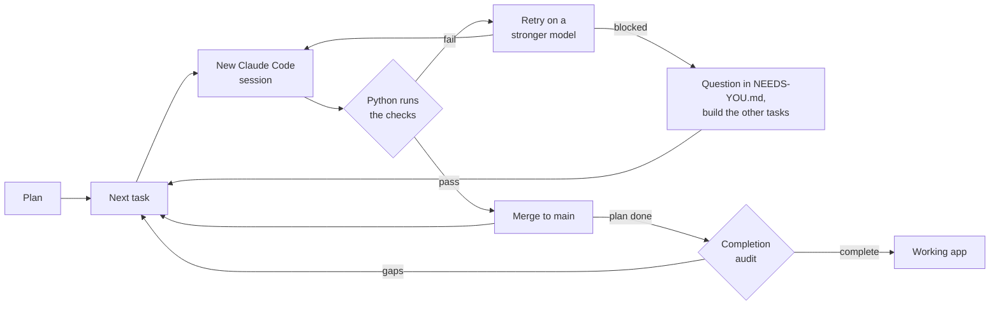

# Autopilot

Autopilot builds your software project while you are away. You write what you want in plain words and start it once. You get working software, tested, with a record of every step.
It is for one developer, or for a person with an idea and a developer friend.

**Give it a plan tonight. Wake up to a working app, and proof that it works.** Claude Code (the coding agent) writes the code; Python code decides when a task is complete.

[](https://github.com/manishjnv/AutoPilot/actions/workflows/ci.yml)

[](LICENSE)

## Claude Code alone and with Autopilot

| | Claude Code alone | With Autopilot |
|---|---|---|
| Direction | Claude can choose the design as it works. | Your plan sets the design. The gate refuses plan changes. |
| Checks | The model can say that work is done. | Autopilot runs your build, lint and test commands. A task merges only if they pass. |
| Failures | You find and repair a problem. | A stronger model tries again. Autopilot repairs a missing tool or a red main branch. |
| Questions | The chat waits for you. | That task waits. Other tasks continue. |
| Status | You scroll the chat. | `ap watch` shows tasks, output, progress and usage. |

The [full comparison](ARCHITECTURE.md#13-claude-code-alone-and-with-autopilot) has ten rows.

## How it works




## Follow the build

`ap watch` shows the build in the terminal; the status page shows the same data in your browser (sample data).


## Real results

Two real projects built from a plan:

- **SecretScan** finds leaked secrets in a repository.
- **envguard** checks `.env` files against a schema and finds secrets in the git history.

| Measure | SecretScan | envguard |
|---|---|---|
| Tasks merged | **27 of 27**: 13 from the plan, 14 from the audits | **21 of 21**: 11 from the plan, 10 from the audits |
| Blocked tasks | **0** | **0** |
| Passed on the first attempt | 25 of 27 | 17 of 21 |
| Decisions that needed a person | **0** | **0** |
| Agent time | 2.2 hours, 38 sessions | 1.4 hours, 42 sessions |
| Cost at API prices | $17.13 | $19.01 |

Both runs used a subscription. The envguard audits found 8 real bugs; Autopilot fixed all. envguard is private; numbers come from the run log.

## Outcome word at the end of every run

Every run ends with one word: `VERIFIED` (the plan is complete), `BLOCKED` (a task is parked), `BUDGET_STOP` (a limit you set ended the run), `STALLED` or `FAILED`. Autopilot stores the word in the state, the log and `run.json`. The run notification starts with it. Type `ap status` to see the line `outcome: <word>`. The line shows only after a run has ended. See [Run outcome](REFERENCE.md#run-outcome).

## Not proven section in PROOF.md

Each phase writes `history/<phase>/PROOF.md`. It has a `## Not proven` section. The section lists each acceptance criterion that no changed test mentions, with its task id. When every criterion has a test, the section holds one sentence that says so. Read this list to see what a green build did not check.

## Replay a recorded run with ap tour

Type `ap tour` to watch a recorded run in the watch window. It needs no login, no key, no network and no agent CLI. It writes no file, not in `.agent/` and not in your home folder. The replay runs at 10 times real time; use `--speed N` to change it. At the end it prints the proof (the outcome word `VERIFIED` and the Not proven list) and the lines `Install: uv tool install dev-autopilot` and `Start: ap`. Use `ap tour --once` to draw only the last frame and exit 0, for CI. The recording is `examples/tour/events.jsonl`: more than 40 events, with no user path, mail address or secret. `scripts/make_tour.py` builds it again from `examples/self-build`. See [REFERENCE.md](REFERENCE.md).

## Fresh-context review on every task

A fresh session reviews each finished task before it merges. Set `review.scope` in `project.yaml`. With `scope: all`, every task above low risk gets a review, and a finding blocks the merge. With `scope: critical`, or no key, only critical tasks get one. This is the code default, so old projects keep today's behavior. `ap init` writes `scope: all`. Any other value is an error with a plain message. The reviewer sees only the task spec (with the acceptance criteria), the diff and the gate's test output. It sees nothing from the build session. See [REFERENCE.md](REFERENCE.md).

## Signed receipt and ap verify

When a phase closes, Autopilot writes `history/<phase>/receipt.json` next to `PROOF.md`. The receipt holds a hash of each phase file and a signature. The key is `~/.autopilot/receipt.key`. Autopilot makes it on first use. It lives in your home folder (`AUTOPILOT_HOME` moves it), so it is never in the repository and never committed.

Type `ap verify` to check every closed phase. It works offline. Use `ap verify <phase>` for one phase. An untouched phase prints `<phase> ok` and the command exits 0. If someone edits `PROOF.md`, it prints `<phase> CHANGED: ...` and exits 1. A different key gives a bad signature report. With no receipt, it prints `no receipt found` and exits 1.

## Draft PR for an unverified task

Set `git.mode: pr` in `project.yaml` and each task opens a pull request. If the gate gave a warning, or an acceptance criterion has no test, the PR opens as a draft. Its body lists each item under `## Not proven`. A clean task opens a ready PR, and the list says "Nothing". When CI is green, Autopilot marks a draft ready and merges it; the list stays in the body. `git.mode: direct` works as before. See [REFERENCE.md](REFERENCE.md).

## Proof card and README badge per phase

When a phase closes, Autopilot writes two files next to `PHASE.md` in `.agent/history/<phase>/`. `proof.svg` is a 600x200 card. It shows the project name, the phase, the tasks merged of the total, the verified features, the cost and the date. It holds no absolute path, and it stays valid XML when a phase title has `<` or `&`. `BADGE.md` holds one markdown image line, ``, and the repo-relative path `.agent/history/<phase>/proof.svg`. Paste that path into your README to show the badge. The signed receipt covers both files. See [REFERENCE.md](REFERENCE.md).

## Install

Three steps, no administrator prompt.

1. Run one line in your shell.

   Windows (PowerShell):

   ```powershell
   irm https://raw.githubusercontent.com/manishjnv/AutoPilot/main/install.ps1 | iex
   ```

   macOS, Linux, WSL or Git Bash:

   ```bash
   curl -fsSL https://raw.githubusercontent.com/manishjnv/AutoPilot/main/install.sh | bash
   ```

   Windows (CMD):

   ```bat
   curl -o %TEMP%\install.cmd https://raw.githubusercontent.com/manishjnv/AutoPilot/main/install.cmd && %TEMP%\install.cmd
   ```

   Have Python 3.10 or newer? `pip install dev-autopilot && ap setup`.

2. Answer one question: which AI do you pay for (Claude, GitHub Copilot, Codex, Cursor or Kiro)? The script
   installs that one CLI and prints its login command. Copilot in VS Code is not a command-line tool. Autopilot
   needs the Copilot CLI, which uses the same subscription.
3. Open a project folder and type `ap`.

See [What `ap` does](HOWTO.md#what-ap-does-in-a-folder). Autopilot updates itself once a day; `ap uninstall --all`
removes it. Checksums and each step: [Install with one script](HOWTO.md#install-with-one-script).

## Example output

Shortened real output:

```text
task P02-T01 attempt 1 failed: PROBLEM: skip/focus marker added in tests/test_walker.py
session #10 task P02-T01 model=sonnet attempt=2
task P02-T01 done (sonnet, $0.39)
audit: completion audit: 92% complete, 8 corrective tasks (FIX001)
```

## Documentation

| To | Read |
|---|---|
| Build your first project | [Tutorial](GUIDE.md) |
| Do one job: a server, phone alerts, an existing project | [How-to guides](HOWTO.md) |
| Look up a command, setting, file or term | [Reference](REFERENCE.md) |
| How Autopilot works and why | [Architecture](ARCHITECTURE.md) |

## Good to know

> [!WARNING]
> Use a sandbox on a server: sessions run without permission prompts. See
> [Run Autopilot on a server](HOWTO.md#run-autopilot-on-a-server).

- Version 0.4.0, an early release. [MIT license](LICENSE).
- One CLI agent per session. See [limits and runners](HOWTO.md#limits-and-supported-agent-clis).